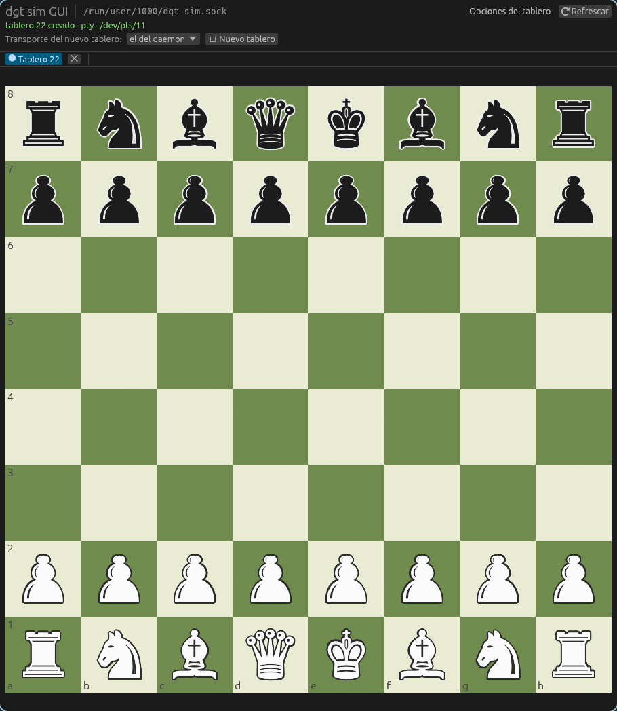
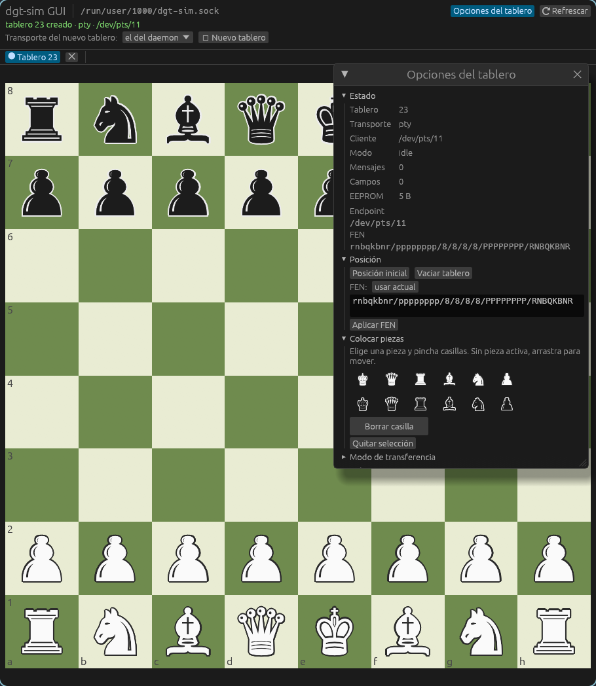

# gui-dgt-sim

A native desktop GUI for [`dgt-sim`](https://github.com/luisfer-cli/dgt-sim), the
DGT electronic-board emulator. It talks to a running daemon over the same
Unix-socket JSON control plane the CLI uses, and gives every simulated board a
draggable chessboard.

Built with [`eframe`/`egui`](https://github.com/emilk/egui) — a single Rust
binary, no browser, no web stack.



## What it does

- **The board is the window.** It fills the space and is centred. Every
  per-board option lives in a **floating window** that starts hidden — open it
  with the **Opciones del tablero** toggle, then drag it anywhere, resize it, or
  close it with its ✕.

  
- **One tab per board.** Every time you open an instance (`＋ Nuevo tablero`,
  and one automatically at startup) the GUI asks the daemon to create a real
  board and binds a tab to it.
- **Draggable board.** Drag a piece to another square (or click origin, then
  destination) and the GUI plays it as a DGT move, so the daemon emits the real
  physical field-update sequence. Dragging is what a client on the board's PTY
  or TCP endpoint would observe.
- **Set the position.** `Posición inicial` resets to the start position,
  `Vaciar tablero` empties it, and a FEN box loads any placement.
- **Place pieces freely.** Pick a piece from the palette and click squares to
  put it there, or use the eraser — useful to build arbitrary test positions.
- **Everything else the daemon exposes:** transfer modes, the emulated clock,
  connect/disconnect, fault injection, and the outbound protocol messages as
  hex, all from the side panel.

## Requirements

- A `dgt-sim` build that supports runtime board creation (the `add` command /
  `create` control request) — commit
  [`6cdc7a0`](https://github.com/luisfer-cli/dgt-sim/commit/6cdc7a0) or later.
- Linux with a graphical session (developed on Wayland/Hyprland).

## Build

```bash
cargo build --release
# binary: target/release/gui-dgt-sim
```

## Run

Start the daemon first (it can have zero extra boards; the GUI creates its own):

```bash
# In one shell: the simulator. TCP is convenient because each board gets a port.
dgt-sim start --boards 1 --transport tcp

# In another shell: the GUI, pointing at the daemon's control socket.
gui-dgt-sim
```

The socket is resolved from the first argument, then `$DGT_SIM_SOCKET`, then the
daemon's own default (`$XDG_RUNTIME_DIR/dgt-sim.sock`, else
`/tmp/dgt-sim-<uid>.sock`). So the plain `gui-dgt-sim` finds a daemon started
with the plain `dgt-sim start`.

A different socket can be chosen explicitly:

```bash
dgt-sim --socket /tmp/demo.sock start --boards 1 --transport tcp
gui-dgt-sim /tmp/demo.sock
```

## How it connects

The daemon's control plane is newline-delimited JSON over a Unix socket, one
request per line and one response per line. The GUI never blocks its render
loop: a background thread performs each blocking round-trip and posts the answer
back, and the visible tab is refreshed every 400 ms so clock and position
changes made by an external client show up live.

```
 GUI (egui)                      background thread            dgt-sim daemon
 ──────────                      ─────────────────            ──────────────
 UI event ──▶ Request ──▶ mpsc ──▶ UnixStream ──▶ JSON line ──▶ control socket
 UI frame ◀── Snapshot ◀── mpsc ◀── response  ◀── JSON line ◀── manager/boards
```

## Layout

```
src/
  main.rs          entry point, socket resolution, font install
  app.rs           the eframe app: tabs, top bar, side panel, board panel
  board_widget.rs  the chessboard: painting plus drag-and-drop / click-to-move
  daemon.rs        non-blocking control-socket client (worker thread + channels)
  protocol.rs      the JSON control-plane types (a mirror of the daemon's)
  model.rs         squares, pieces and FEN parsing
  fonts.rs         loads a system font with the Unicode chess glyphs
```

## Tests

```bash
cargo test      # model, protocol serialisation and headless widget interaction
cargo clippy --all-targets -- -D warnings
```

The widget tests drive the board with synthetic pointer events through
`egui::Context::run_ui`, so drag-and-drop, click-to-move and palette clicks are
covered without a display.

## License

Dual-licensed under either of

- Apache License, Version 2.0 ([LICENSE-APACHE](LICENSE-APACHE))
- MIT license ([LICENSE-MIT](LICENSE-MIT))

at your option.
